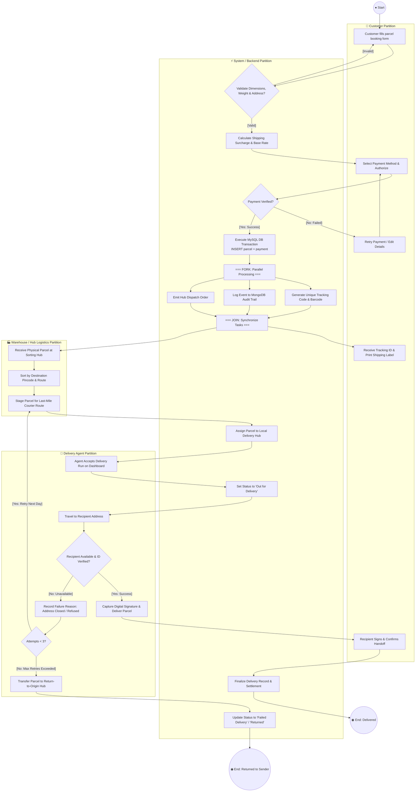
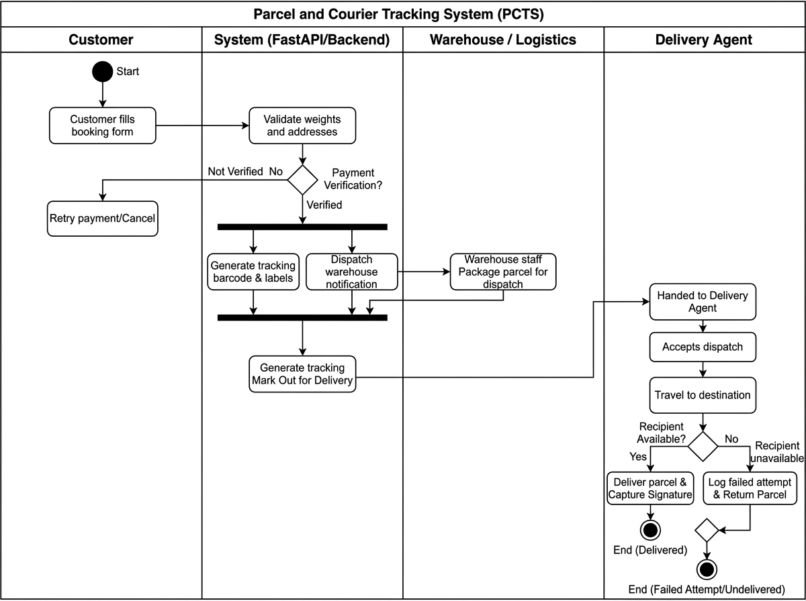

# Activity Diagram

## What is an Activity Diagram?

An **Activity Diagram** is a behavioral UML diagram that models the **flow of control and data** from one activity to another within a business process or software system.

Unlike a State Diagram (which focuses on the changing internal states of a single entity, like a Parcel), an Activity Diagram visualizes the **step-by-step logic, parallel executions, decisions, and cross-functional responsibilities** across multiple actors.

Key elements of UML Activity Diagrams include:
- **Initial Node (●):** The starting point of the business workflow.
- **Activity / Action States (Rounded Boxes):** Tasks or actions performed by actors or backend services.
- **Control Flows (Arrows):** The sequence in which activities execute.
- **Decision Nodes (◇):** Branching points where guard conditions determine the path taken (e.g., `[Payment Succeeded]` vs `[Payment Failed]`).
- **Merge Nodes (◇):** Convergence points where multiple alternate paths combine back into a single flow.
- **Fork Bars (▬):** Splits a single flow into multiple concurrent (parallel) tasks.
- **Join Bars (▬):** Synchronizes multiple parallel tasks back together before moving to the next step.
- **Swimlanes (Partitions):** Columns that assign responsibility for each action to a specific actor or system component.
- **Activity Final Node (◉):** The successful or terminal conclusion of the workflow.

---

## Swimlanes in PCTS

The PCTS end-to-end delivery lifecycle spans four distinct organizational partitions:

```
┌──────────────┬────────────────────────┬──────────────────────┬──────────────────┐
│   Customer   │  System (FastAPI & DB) │ Warehouse / Sorting  │  Delivery Agent  │
└──────────────┴────────────────────────┴──────────────────────┴──────────────────┘
```

1. **Customer:** Enters booking data, authorizes payment, views tracking progress, signs for parcel.
2. **System (FastAPI / Database):** Validates constraints, calculates freight rates, executes MySQL transactions, emits MongoDB audit events, issues barcodes.
3. **Warehouse / Logistics:** Receives package, performs physical weighing & sorting, stages parcel for dispatch.
4. **Delivery Agent:** Accepts delivery run, navigates to recipient address, collects OTP / signature, records delivery outcome.

---

## End-to-End Activity Flow (Mermaid Swimlane Diagram)



---

## Decision Nodes & Guard Conditions

| Decision Point | Guard Condition | Path Taken | Action / Result |
|---|---|---|---|
| **Data Validation** | `[Payload Valid]` | System Rate Calculation | Calculate distance, weight, dimensional volume. |
| | `[Payload Invalid]` | Back to Customer | Highlight validation errors (e.g. source == destination). |
| **Payment Verification** | `[Authorized]` | Fork Synchronization | Execute atomic DB transaction and dispatch order. |
| | `[Declined / Timeout]` | Customer Retry | Prompt customer for alternative payment method. |
| **Delivery Handover** | `[Recipient Available]` | Success Path | Capture recipient signature and timestamp. |
| | `[Recipient Unavailable]` | Retry / Return Logic | Record failed attempt reason with geolocation coordinates. |
| **Retry Threshold** | `[Attempts < 3]` | Re-stage in Hub | Parcel scheduled for next business day delivery window. |
| | `[Attempts >= 3]` | Return-to-Origin | Parcel flagged as `Returned` and routed back to sender. |

---

## Parallelism & Concurrency (Fork & Join)

When a parcel booking transaction completes successfully, PCTS utilizes an asynchronous fork to initiate three tasks in parallel:
1. **Barcode Generation:** Creation of standard Code-128 / QR barcodes containing the Tracking ID for thermal label printing.
2. **MongoDB NoSQL Audit Stream:** Non-blocking insertion of the `BOOKED` event payload containing sender coordinates and initial system timestamps.
3. **Logistics Dispatch Notification:** Dispatching inventory notification messages to the origin logistics hub for physical parcel intake.

The **Join Bar** ensures that the customer receives confirmation only after the tracking code has been minted and data consistency is secured across databases.

---

## Visual Diagram

The high-resolution UML Activity Diagram below illustrates the end-to-end business process flow across all system swimlanes:



---

## Status

✅ **Completed and Verified in Documentation Suite.**
