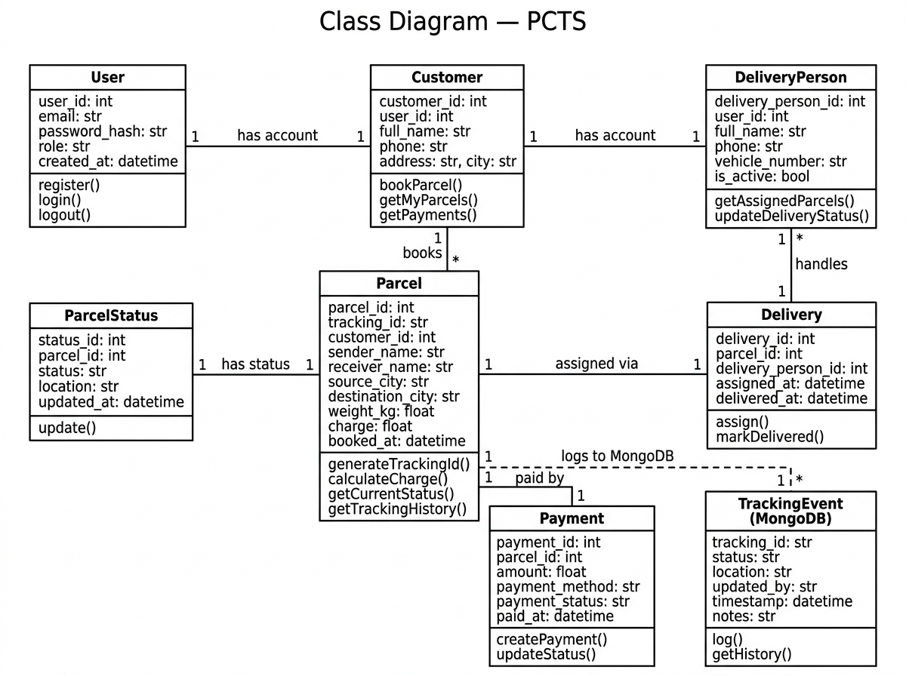

# Class Diagram

## What is a Class Diagram?

A Class Diagram is a type of UML diagram that shows the **structure of the system's data
and logic** as a set of classes (objects). For this project, it shows what information
each entity holds (attributes) and what it can do (methods/operations).

In a database-backed system, class diagrams map closely to the database tables — but
they also capture the behavior (methods) that the application code will implement.

---

## Classes in PCTS

---

### User
Represents a person who can log into the system.

| Attributes        | Type    |
|-------------------|---------|
| user_id           | int     |
| email             | str     |
| password_hash     | str     |
| role              | str     |
| created_at        | datetime|

| Methods           | Description                  |
|-------------------|------------------------------|
| register()        | Create a new user account    |
| login()           | Authenticate and return token|
| logout()          | Invalidate user session      |

---

### Customer
Represents a registered customer (linked to User).

| Attributes    | Type |
|---------------|------|
| customer_id   | int  |
| user_id       | int  |
| full_name     | str  |
| phone         | str  |
| address       | str  |
| city          | str  |

| Methods          | Description                          |
|------------------|--------------------------------------|
| bookParcel()     | Create a new parcel booking          |
| getMyParcels()   | Retrieve all parcels booked by this customer |
| getPayments()    | Retrieve all payments by this customer |

---

### DeliveryPerson
Represents a delivery staff member (linked to User).

| Attributes          | Type    |
|---------------------|---------|
| delivery_person_id  | int     |
| user_id             | int     |
| full_name           | str     |
| phone               | str     |
| vehicle_number      | str     |
| is_active           | bool    |

| Methods               | Description                                  |
|-----------------------|----------------------------------------------|
| getAssignedParcels()  | View all parcels assigned to this person     |
| updateDeliveryStatus()| Update the status of an assigned parcel      |

---

### Parcel
Represents a parcel booking. This is the central class.

| Attributes        | Type    |
|-------------------|---------|
| parcel_id         | int     |
| tracking_id       | str     |
| customer_id       | int     |
| sender_name       | str     |
| sender_phone      | str     |
| receiver_name     | str     |
| receiver_phone    | str     |
| source_city       | str     |
| destination_city  | str     |
| parcel_type       | str     |
| weight_kg         | float   |
| description       | str     |
| charge            | float   |
| booked_at         | datetime|

| Methods               | Description                              |
|-----------------------|------------------------------------------|
| generateTrackingId()  | Auto-generate a unique Tracking ID       |
| calculateCharge()     | Calculate delivery charge based on weight|
| getCurrentStatus()    | Return the current parcel status         |
| getTrackingHistory()  | Return all tracking events from MongoDB  |

---

### ParcelStatus
Represents the current status of a parcel.

| Attributes    | Type    |
|---------------|---------|
| status_id     | int     |
| parcel_id     | int     |
| status        | str     |
| location      | str     |
| updated_at    | datetime|

| Methods       | Description                       |
|---------------|-----------------------------------|
| update()      | Change the status and location    |

---

### Delivery
Represents the assignment of a parcel to a delivery person.

| Attributes          | Type    |
|---------------------|---------|
| delivery_id         | int     |
| parcel_id           | int     |
| delivery_person_id  | int     |
| assigned_at         | datetime|
| delivered_at        | datetime|

| Methods         | Description                              |
|-----------------|------------------------------------------|
| assign()        | Link a delivery person to a parcel       |
| markDelivered() | Record the delivery completion timestamp |

---

### Payment
Represents the payment for a parcel booking.

| Attributes       | Type    |
|------------------|---------|
| payment_id       | int     |
| parcel_id        | int     |
| amount           | float   |
| payment_method   | str     |
| payment_status   | str     |
| paid_at          | datetime|

| Methods         | Description                             |
|-----------------|-----------------------------------------|
| createPayment() | Create a payment record for a parcel    |
| updateStatus()  | Change the payment status               |

---

### TrackingEvent (MongoDB Document)
Represents a single event in a parcel's tracking history.
This is NOT a MySQL table — it is a MongoDB document.

| Attributes   | Type    |
|--------------|---------|
| tracking_id  | str     |
| status       | str     |
| location     | str     |
| updated_by   | str     |
| timestamp    | datetime|
| notes        | str     |

| Methods   | Description                             |
|-----------|-----------------------------------------|
| log()     | Save a new tracking event to MongoDB    |
| getHistory() | Retrieve all events for a tracking_id|

---

## Relationships Between Classes

| Relationship              | Type          | Description                                        |
|---------------------------|---------------|----------------------------------------------------|
| User → Customer           | One-to-One    | One user account can be one customer               |
| User → DeliveryPerson     | One-to-One    | One user account can be one delivery person        |
| Customer → Parcel         | One-to-Many   | One customer can book many parcels                 |
| Parcel → ParcelStatus     | One-to-One    | Each parcel has one current status                 |
| Parcel → Delivery         | One-to-One    | Each parcel has one delivery assignment            |
| DeliveryPerson → Delivery | One-to-Many   | One delivery person can handle many deliveries     |
| Parcel → Payment          | One-to-One    | Each parcel has one payment record                 |
| Parcel → TrackingEvent    | One-to-Many   | One parcel can have many tracking history events   |

---

## Instructions for Drawing the Actual Diagram

1. Open [draw.io](https://app.diagrams.net/) in your browser.
2. Create a new blank diagram.
3. Add a rectangle for each class. The top section is the class name.
   The middle section lists attributes. The bottom section lists methods.
4. Draw lines between classes to show relationships.
   - Use a line with a "1" and "1" on each end for one-to-one.
   - Use a line with a "1" and "*" on each end for one-to-many.
5. Export as PNG and save as `class-diagram.png` in this folder.
6. Update this file to embed the image:
   ``

---

## Diagram

## Status

✅ Completed in Phase 2.
