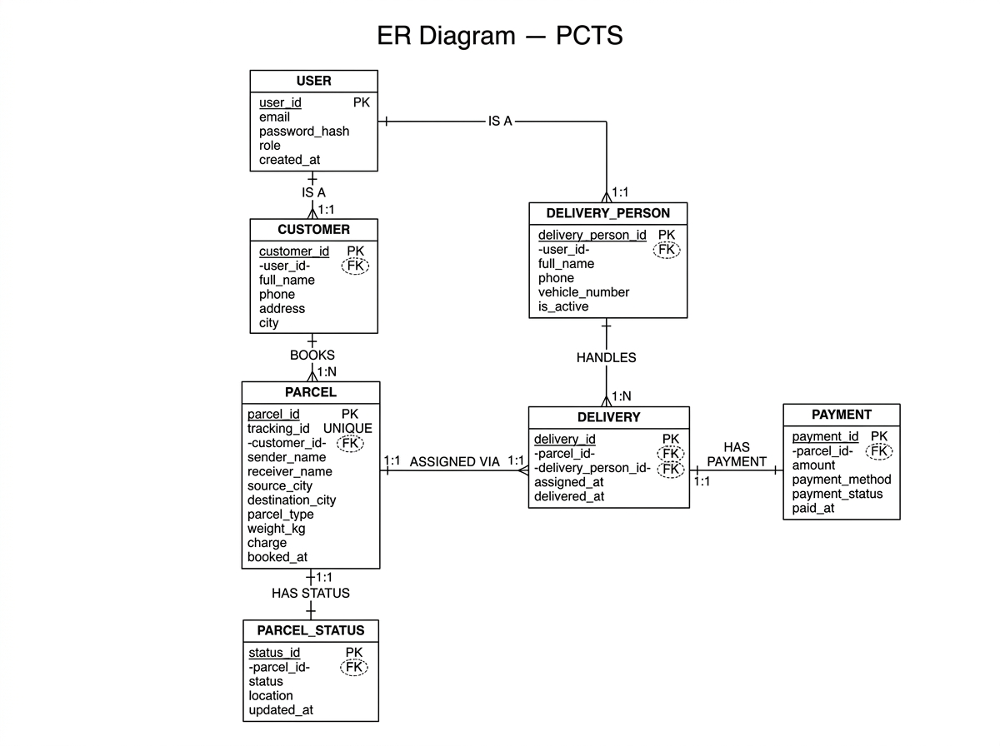

# ER Diagram (Entity-Relationship Diagram)

## What is an ER Diagram?

An ER (Entity-Relationship) Diagram is used in database design to show:

- **Entities** — the "things" we store data about (like Customer, Parcel, Payment).
- **Attributes** — the pieces of information we store for each entity (like name, phone, weight).
- **Relationships** — how entities are connected to each other (like a Customer "books" a Parcel).
- **Cardinality** — how many of one entity relate to another (one-to-one, one-to-many).

An ER diagram is drawn BEFORE creating the database, so it acts as a blueprint.

---

## Entities and Their Attributes

### User
- **user_id** (PK)
- email (UNIQUE)
- password_hash
- role (customer / admin / delivery)
- created_at

### Customer
- **customer_id** (PK)
- user_id (FK → User)
- full_name
- phone
- address
- city

### DeliveryPerson
- **delivery_person_id** (PK)
- user_id (FK → User)
- full_name
- phone
- vehicle_number
- is_active

### Parcel
- **parcel_id** (PK)
- tracking_id (UNIQUE)
- customer_id (FK → Customer)
- sender_name
- sender_phone
- receiver_name
- receiver_phone
- source_city
- destination_city
- parcel_type
- weight_kg
- description
- charge
- booked_at

### ParcelStatus
- **status_id** (PK)
- parcel_id (FK → Parcel, UNIQUE)
- status
- location
- updated_at

### Delivery
- **delivery_id** (PK)
- parcel_id (FK → Parcel, UNIQUE)
- delivery_person_id (FK → DeliveryPerson)
- assigned_at
- delivered_at

### Payment
- **payment_id** (PK)
- parcel_id (FK → Parcel, UNIQUE)
- amount
- payment_method
- payment_status
- paid_at

---

## Relationships

| Relationship         | Entities Involved         | Cardinality    | Description                                           |
|----------------------|---------------------------|----------------|-------------------------------------------------------|
| IS-A (has account)   | User ↔ Customer           | 1 : 1          | One user is one customer                              |
| IS-A (has account)   | User ↔ DeliveryPerson     | 1 : 1          | One user is one delivery person                       |
| BOOKS                | Customer ↔ Parcel         | 1 : Many       | One customer can book many parcels                    |
| HAS STATUS           | Parcel ↔ ParcelStatus     | 1 : 1          | One parcel has one current status row                 |
| IS ASSIGNED TO       | Parcel ↔ Delivery         | 1 : 1          | One parcel has one delivery assignment                |
| HANDLES              | DeliveryPerson ↔ Delivery | 1 : Many       | One delivery person handles many deliveries           |
| HAS PAYMENT          | Parcel ↔ Payment          | 1 : 1          | One parcel has one payment record                     |

---

## Text Representation of the ER Structure

```
User ─────────── Customer ──────── Parcel ──────── ParcelStatus
 │                                    │
 └── DeliveryPerson                   ├──────── Delivery ──── DeliveryPerson
                                      │
                                      └──────── Payment
```

---

## ER Diagram Notation Guide

When drawing the ER diagram, use the following standard shapes:

| Shape               | Represents     | Example                  |
|---------------------|----------------|--------------------------|
| Rectangle           | Entity         | Customer, Parcel         |
| Ellipse / Oval      | Attribute      | full_name, tracking_id   |
| Underlined attribute| Primary Key    | customer_id              |
| Diamond             | Relationship   | BOOKS, HAS PAYMENT       |
| Line with numbers   | Cardinality    | 1, N (or 1, *)           |

---

## Instructions for Drawing the Actual Diagram

1. Open [draw.io](https://app.diagrams.net/) in your browser.
2. Select the "Entity Relation" shape library from the left panel.
3. Draw each entity as a rectangle.
4. Add attribute ellipses connected to each entity.
5. Underline the primary key attribute.
6. Draw diamond shapes for relationships between entities.
7. Add cardinality labels (1 or N) on the lines near each entity.
8. Export as PNG and save as `er-diagram.png` in this folder.
9. Update this file to embed the image:
   ``

---

## Note on MongoDB

The tracking history stored in MongoDB is **not included in the ER diagram** because
MongoDB is a document database (not relational). There are no foreign keys or strict
relationships in MongoDB — the `tracking_id` field in each MongoDB document is just
a string that matches the `tracking_id` in the MySQL Parcel table.

---

## Diagram



## Status

✅ Completed in Phase 2.
