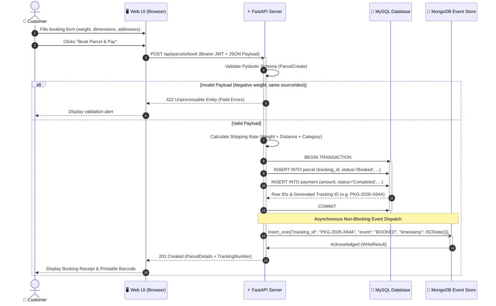
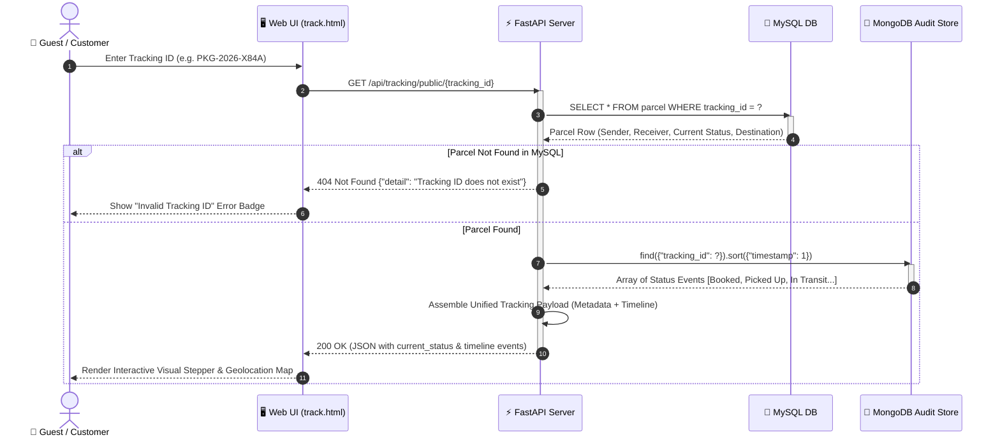
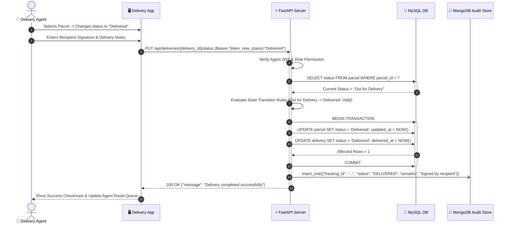
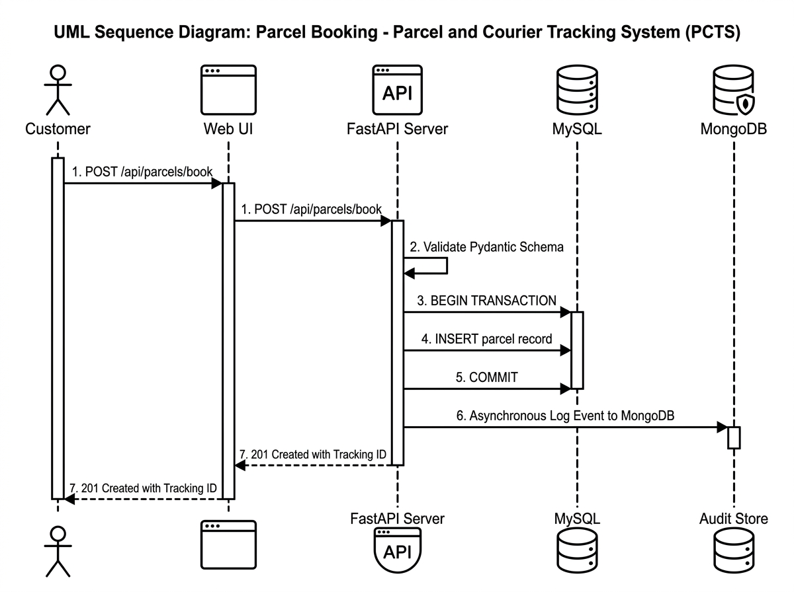

# Sequence Diagram

## What is a Sequence Diagram?

A **Sequence Diagram** is an interaction diagram in the Unified Modeling Language (UML) that depicts **how objects, services, and actors collaborate over time** to carry out a specific scenario.

It emphasizes the **chronological sequence** of messages exchanged across system boundaries, showing:
- **Actors & Lifelines:** The entities participating in the interaction (Customer, Web Frontend, API Gateway, Databases).
- **Activation Bars:** The duration during which an entity is actively performing a computation.
- **Synchronous Calls (Solid arrows with filled heads):** Request-response calls where the caller waits for a result.
- **Asynchronous Calls (Solid arrows with open heads):** Fire-and-forget messages (e.g., logging an event to MongoDB).
- **Return Messages (Dashed arrows):** Data returned back up the stack.
- **Combined Fragments (Alt / Opt):** Conditional logic, exception handling, and transaction rollbacks.

In the Parcel and Courier Tracking System (PCTS), sequence diagrams capture the mission-critical workflows of **parcel booking**, **dual-database persistence (MySQL + MongoDB)**, **real-time parcel tracking**, and **delivery state transitions**.

---

## Participating Lifelines in PCTS

| Lifeline | Role & Responsibility in PCTS Architecture |
|---|---|
| **Customer / Actor** | Initiates requests via browser (signs in, inputs booking details, tracks parcels). |
| **Web UI (Frontend)** | Vanilla JS client running on the browser (`api.js`, `book_parcel.js`, `track.js`). Manages JWT bearer tokens and DOM updates. |
| **FastAPI Server** | ASGI Python application handling routing, Pydantic schema validation, and JWT RBAC authorization. |
| **MySQL (RDBMS)** | Relational engine handling ACID transactions, foreign keys, triggers, and relational tables (`parcel`, `payment`, `customer`). |
| **MongoDB (NoSQL)** | Append-only document collection (`tracking_events`) acting as an immutable audit trail and real-time status timeline. |

---

## Core Scenarios

### Scenario 1: Parcel Booking & Dual-Database Settlement (Primary Workflow)

This scenario models the complete parcel registration flow from form submission to confirmation.

---

### Scenario 2: Public Parcel Tracking & Audit Timeline Aggregation

This scenario depicts how any customer or guest retrieves parcel details and its chronological movement history.

---

### Scenario 3: Delivery Status Update & State Machine Transition

This scenario traces how an authenticated Delivery Agent updates the state of a parcel upon physical handoff.

---

## Detailed Message Catalog

| Msg # | Sender | Receiver | Message Name | Parameters / Content | Response / Side Effect |
|---|---|---|---|---|---|
| **1** | Customer | Web UI | `Submit Booking` | Weight, category, source city, destination city, sender & receiver info | UI validates non-empty inputs |
| **2** | Web UI | FastAPI | `POST /api/parcels/book` | `Authorization: Bearer <jwt>`, JSON parcel payload | API begins processing |
| **3** | FastAPI | Internal | `Validate Schema` | `ParcelCreate` Pydantic model | Rejects with 422 if invalid |
| **4** | FastAPI | MySQL | `BEGIN TRANSACTION` | SQL isolation level Read Committed | Starts transactional boundary |
| **5** | FastAPI | MySQL | `INSERT INTO parcel` | Tracking ID, sender ID, receiver details, dimensions, shipping cost | Generates new relational row |
| **6** | FastAPI | MySQL | `INSERT INTO payment` | `amount`, `payment_method`, `payment_status` | Relational payment row created |
| **7** | FastAPI | MySQL | `COMMIT` | Transaction confirmation | Locks released, changes persisted |
| **8** | FastAPI | MongoDB | `insert_one()` | `tracking_id`, `event_type`, `location`, `timestamp` | Audit timeline document stored |
| **9** | FastAPI | Web UI | `201 Created` | Complete parcel object with generated Tracking Number | UI transitions to confirmation screen |

---

## Visual Diagram

The high-resolution UML Sequence Diagram rendered below illustrates the core **Parcel Booking & Asynchronous Dual-Store Settlement** workflow:

---

## Status

✅ **Completed and Verified in Documentation Suite.**
