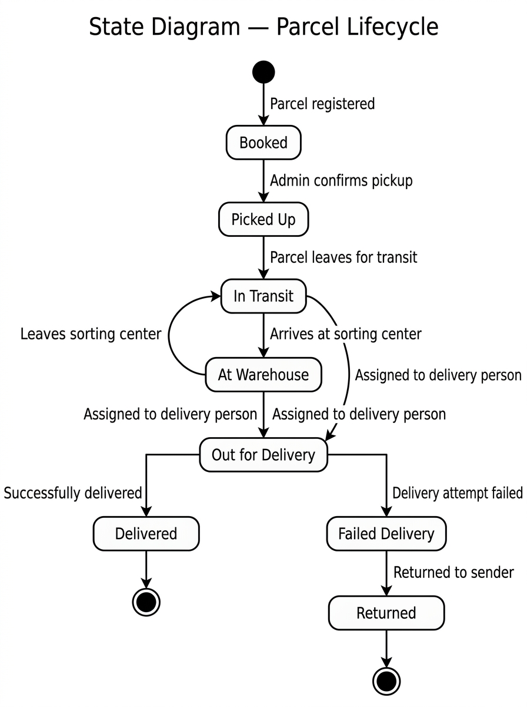

# State Diagram

## What is a State Diagram?

A State Diagram (also called a State Machine Diagram) is a UML diagram that shows
**all possible states an object can be in** and **the events that cause it to move
from one state to another**.

In PCTS, the most important thing with states is the **Parcel** — because a parcel
goes through many different stages from the moment it is booked until it is delivered.

---

## States of a Parcel

| State               | Meaning                                                           |
|---------------------|-------------------------------------------------------------------|
| **Booked**          | The parcel has been registered in the system. Awaiting pickup.    |
| **Picked Up**       | The parcel has been collected from the sender.                    |
| **In Transit**      | The parcel is on its way between locations.                       |
| **At Warehouse**    | The parcel is temporarily held at an intermediate sorting center. |
| **Out for Delivery**| The parcel is with the delivery person, heading to the receiver.  |
| **Delivered**       | The parcel has been successfully delivered to the receiver.       |
| **Failed Delivery** | Delivery was attempted but unsuccessful (e.g., nobody home).     |
| **Returned**        | The parcel has been returned to the sender.                       |

---

## Valid State Transitions

A parcel can only move between states in the ways shown below.
Jumping backwards (e.g., from Delivered back to Booked) is NOT allowed.

```
[Start]
   │
   ▼
┌────────┐
│ Booked │
└────────┘
   │  Admin confirms pickup
   ▼
┌───────────┐
│ Picked Up │
└───────────┘
   │  Parcel leaves for transit
   ▼
┌────────────┐
│ In Transit │  ◄───────────────────────┐
└────────────┘                          │
   │  Arrives at sorting center         │
   ▼                                    │
┌──────────────┐                        │
│ At Warehouse │ ───── Leaves again ────┘
└──────────────┘
   │  Assigned to delivery person
   ▼
┌─────────────────┐
│ Out for Delivery │
└─────────────────┘
   │                    │
   │ Successful         │ Unsuccessful
   ▼                    ▼
┌───────────┐     ┌────────────────┐
│ Delivered │     │ Failed Delivery │
└───────────┘     └────────────────┘
   │                    │
[End]                   │ Parcel returned to sender
                        ▼
                  ┌──────────┐
                  │ Returned │
                  └──────────┘
                       │
                     [End]
```

---

## Transition Table

| From State        | Event / Trigger                      | To State           |
|-------------------|--------------------------------------|--------------------|
| Booked            | Admin confirms pickup                | Picked Up          |
| Picked Up         | Parcel leaves for transit            | In Transit         |
| In Transit        | Parcel arrives at sorting center     | At Warehouse       |
| At Warehouse      | Parcel leaves for transit again      | In Transit         |
| At Warehouse      | Assigned to delivery person          | Out for Delivery   |
| In Transit        | Assigned to delivery person          | Out for Delivery   |
| Out for Delivery  | Successfully delivered               | Delivered          |
| Out for Delivery  | Delivery attempt failed              | Failed Delivery    |
| Failed Delivery   | Parcel returned to sender            | Returned           |

---

## Invalid Transitions (Must Be Blocked)

The system must reject any attempt to set a parcel to these invalid states:

| Attempt                                    | Reason It Is Invalid              |
|--------------------------------------------|-----------------------------------|
| Delivered → any other state                | A delivered parcel is final.      |
| Returned → any other state                 | A returned parcel is final.       |
| Booked → Out for Delivery (skip steps)     | Steps cannot be skipped.          |
| In Transit → Delivered (skip pickup)       | Steps cannot be skipped.          |

---

## Instructions for Drawing the Actual Diagram

1. Open [draw.io](https://app.diagrams.net/) in your browser.
2. Use the "UML" shape library — choose "State" shapes (rounded rectangles).
3. Add a filled circle as the start state and a double circle as the end state.
4. Draw each state as a rounded rectangle with the state name inside.
5. Draw arrows (transitions) between states.
6. Label each arrow with the event that triggers the transition.
7. Export as PNG and save as `state-diagram.png` in this folder.
8. Update this file to embed the image:
   ``

---

## Diagram



## Status

✅ Completed in Phase 2.
