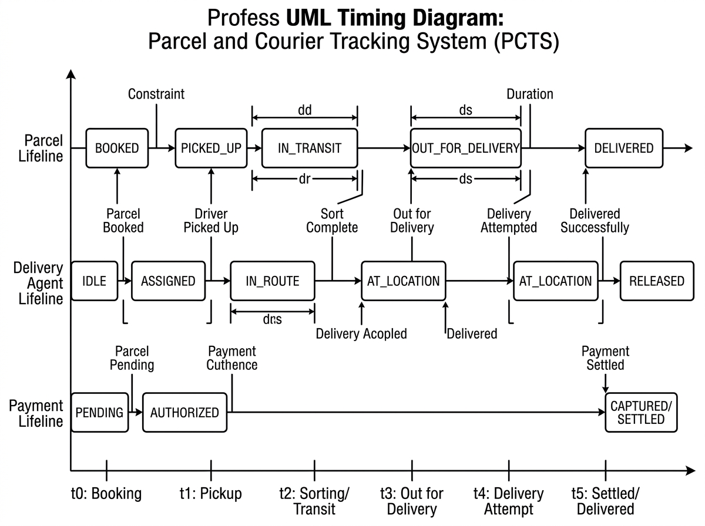

# Timing Diagram

## What is a Timing Diagram?

A **Timing Diagram** is a specialized interaction diagram in the Unified Modeling Language (UML) that focuses on **how conditions and states change along a continuous, linear time axis**.

While Sequence Diagrams emphasize the *order of messages* between objects, Timing Diagrams emphasize the **duration of states**, **exact time constraints**, and **state changes caused by trigger events**.

Key elements of UML Timing Diagrams include:
- **Time Axis (Horizontal Axis):** Represents linear progression of time (marked in milestones: $t_0, t_1, t_2, \dots$ or hours/minutes).
- **State Lifelines (Vertical Lanes):** Depicts the current discrete state of a specific classifier or subsystem over time.
- **State Transitions (Waveform steps):** The step changes when an object moves from one state to another.
- **Duration Constraints (Brackets `|← d →|`):** The minimum, maximum, or expected elapsed time allowed for a state or activity (e.g., SLA windows).
- **Time Constraints:** Specific time deadlines by which an event must occur.
- **Stimulus Events (Annotations):** External signals or API triggers that precipitate state transitions.

In the Parcel and Courier Tracking System (PCTS), timing diagrams define the **temporal contracts, Service Level Agreements (SLAs), and state lifecycles** of Parcels, Delivery Agents, and Payment Settlements.

---

## Participating Lifelines & Discrete States

| Lifeline | Monitored Object | Possible Discrete States |
|---|---|---|
| **Parcel Lifeline** | Physical shipment tracking record | `BOOKED` &rarr; `PICKED_UP` &rarr; `IN_TRANSIT` &rarr; `AT_WAREHOUSE` &rarr; `OUT_FOR_DELIVERY` &rarr; `DELIVERED` (or `FAILED` &rarr; `RETURNED`) |
| **Delivery Agent Lifeline** | Courier personnel duty status | `IDLE` &rarr; `ASSIGNED` &rarr; `IN_ROUTE` &rarr; `AT_LOCATION` &rarr; `RELEASED / IDLE` |
| **Payment Lifeline** | Financial transaction record | `INITIATED` &rarr; `AUTHORIZED` &rarr; `CAPTURED (SETTLED)` (or `REFUNDED`) |
| **Database Transaction Lifeline** | Relational ACID session | `IDLE` &rarr; `ROW_LOCKED` (`SELECT FOR UPDATE`) &rarr; `COMMITTED` &rarr; `ASYNC_STREAM` |

---

## Timeline Milestones & State Waveform

The following timing model shows the coordinated state progression across all three core lifelines from initial customer booking through final delivery settlement:

```
State Lifeline              t0             t1              t2                  t3             t4             t5
                             │              │               │                   │              │              │
[Parcel]                     │              │               │                   │              │              │
 DELIVERED                   │              │               │                   │              │       ┌──────►
 OUT_FOR_DELIVERY            │              │               │                   │       ┌──────┴───────┘      │
 IN_TRANSIT                  │              │        ┌──────┴───────────────────┘       │                     │
 PICKED_UP                   │       ┌──────┴────────┘                                  │                     │
 BOOKED               ┌──────┴───────┘                                                  │                     │
                      │                                                                 │                     │
[Delivery Agent]      │                                                                 │                     │
 RELEASED/IDLE        │                                                                 │              ┌──────►
 AT_LOCATION          │                                                                 │       ┌──────┘      │
 IN_ROUTE             │                                                         ┌───────┴───────┘             │
 ASSIGNED             │              ┌──────────────────────────────────────────┘                             │
 IDLE                 └──────────────┘                                                                        │
                      │                                                                                       │
[Payment]             │                                                                                       │
 CAPTURED/SETTLED     │                                                                                ┌──────►
 AUTHORIZED           │       ┌────────────────────────────────────────────────────────────────────────┘      │
 PENDING              ┌───────┘                                                                               │
                      │                                                                                       │
                      ▼              ▼               ▼                   ▼              ▼              ▼
Milestone:         t0: Booking    t1: Pickup    t2: Sorting/Transit   t3: Out for    t4: Delivery   t5: Settled/
                   & Payment      by Courier    & Hub Processing      Delivery       Attempt        Delivered
```

---

## Timing Constraints & Service Level Agreements (SLAs)

| Interval | Milestone Range | Duration Constraint ($d$) | SLA Rule & System Behavior |
|---|---|---|---|
| **$d_1$: Payment Authorization** | $t_0 \to t_0 + \Delta t$ | $t \le 60\text{ seconds}$ | Gateway checkout window. If no token received within 60s, transaction expires and reservation is rolled back. |
| **$d_2$: Pickup Assignment** | $t_0 \to t_1$ | $d \le 4\text{ hours}$ | System alerts dispatch operations if parcel remains in `BOOKED` state without a scheduled pickup after 4 hours. |
| **$d_3$: Sorting & Hub Transit** | $t_1 \to t_2$ | $12\text{ hours} \le d \le 24\text{ hours}$ | Standard inter-city surface logistics window. Exceeding 24 hours triggers an automatic transit delay flag. |
| **$d_4$: Out for Delivery Run** | $t_3 \to t_4$ | $d \le 8\text{ hours}$ | Last-mile courier shift duration. Must attempt delivery before 19:00 local time. |
| **$d_5$: Doorstep Attempt & Verification** | $t_4 \to t_5$ | $3\text{ minutes} \le d \le 10\text{ minutes}$ | Driver wait time at recipient location. Geofenced timer requires digital signature or OTP verification. |
| **$d_6$: Payment Capture & Closeout** | $t_4 \to t_5$ | $t \le 5\text{ seconds}$ | Funds transfer settled, invoice receipt generated, and MongoDB audit log finalized. |

---

## State Transition Trigger Catalog

1. **Trigger $E_0$ at $t_0$ (Order Placed):**
   - Action: `POST /api/parcels/book`
   - Parcel moves from *Unregistered* &rarr; `BOOKED`.
   - Payment moves from *Uninitialized* &rarr; `PENDING`.
2. **Trigger $E_1$ at $t_1$ (Courier Intake):**
   - Action: Agent scans physical barcode at customer premises.
   - Parcel moves from `BOOKED` &rarr; `PICKED_UP`.
   - Payment moves from `PENDING` &rarr; `AUTHORIZED`.
3. **Trigger $E_2$ at $t_2$ (Hub Inbound Scan):**
   - Action: Optical sortation belt scan at central warehouse.
   - Parcel moves from `PICKED_UP` &rarr; `IN_TRANSIT` &rarr; `AT_WAREHOUSE`.
4. **Trigger $E_3$ at $t_3$ (Out for Delivery Assignment):**
   - Action: Delivery person loads parcel onto route van.
   - Parcel moves from `AT_WAREHOUSE` &rarr; `OUT_FOR_DELIVERY`.
   - Agent moves from `IDLE` &rarr; `ASSIGNED` &rarr; `IN_ROUTE`.
5. **Trigger $E_4$ at $t_4$ (Arrival at Recipient):**
   - Action: Mobile GPS triggers geofence proximity alert (< 50m).
   - Agent moves from `IN_ROUTE` &rarr; `AT_LOCATION`.
6. **Trigger $E_5$ at $t_5$ (Proof of Delivery Submission):**
   - Action: `PUT /api/deliveries/{id}/status` with OTP / signature payload.
   - Parcel moves from `OUT_FOR_DELIVERY` &rarr; `DELIVERED`.
   - Agent moves from `AT_LOCATION` &rarr; `RELEASED / IDLE`.
   - Payment moves from `AUTHORIZED` &rarr; `CAPTURED / SETTLED`.

---

## Visual Diagram

The high-resolution UML Timing Diagram below illustrates the time-indexed waveform lifelines and duration constraints across system components:



---

## Status

✅ **Completed and Verified in Documentation Suite.**
