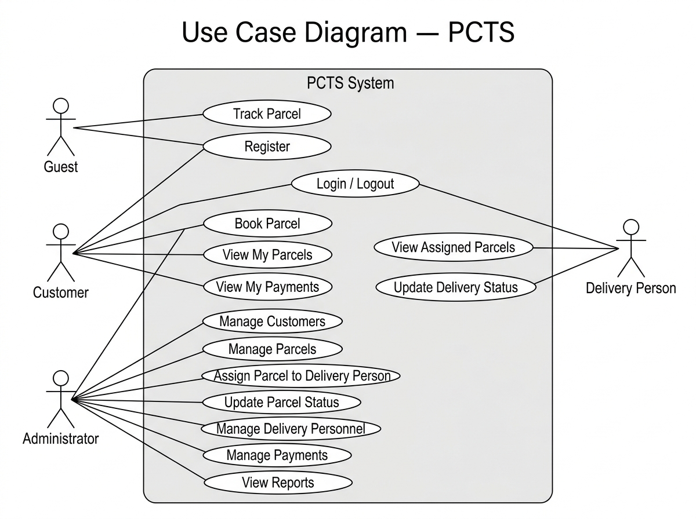

# Use Case Diagram

## What is a Use Case Diagram?

A Use Case Diagram is a type of UML (Unified Modeling Language) diagram.
It shows **who uses the system** (called Actors) and **what they can do** (called Use Cases).

It does NOT show how things work internally — only WHAT the system does from the user's perspective.

---

## Actors in PCTS

| Actor             | Description                                                     |
|-------------------|-----------------------------------------------------------------|
| **Customer**      | A registered user who sends parcels.                            |
| **Administrator** | A staff member who manages the entire system.                   |
| **Delivery Person** | A staff member who delivers parcels to receivers.             |
| **Guest (Unregistered User)** | Anyone who visits the website without logging in. |

---

## Use Cases per Actor

### Guest (Unregistered User)
- Track a parcel using a Tracking ID (public access).
- Register as a new customer.

### Customer
- Log in / Log out.
- Book a new parcel.
- View their own parcel list.
- Track a parcel by Tracking ID.
- View their payment details.

### Administrator
- Log in / Log out.
- Manage customers (view, update, delete).
- Manage parcels (view, update).
- Assign a parcel to a delivery person.
- Update parcel status.
- Manage delivery personnel (add, view, deactivate).
- View and update payment records.
- View reports (parcel, delivery, payment summaries).

### Delivery Person
- Log in / Log out.
- View assigned parcels.
- Update the delivery status of their assigned parcel.

---

## Diagram Description

Draw the following diagram using draw.io or similar tool and save the image here.

```
                    ┌─────────────────────────────────────────────────────────┐
                    │                   PCTS System                            │
                    │                                                          │
  ┌──────────┐      │   ○ Track Parcel (public)                               │
  │  Guest   │ ─────│───────────────────────────────────────────────────────  │
  └──────────┘      │   ○ Register                                            │
                    │                                                          │
  ┌──────────┐      │   ○ Login / Logout                                      │
  │ Customer │ ─────│   ○ Book Parcel                                         │
  └──────────┘      │   ○ Track Parcel                                        │
                    │   ○ View My Parcels                                     │
                    │   ○ View My Payments                                    │
                    │                                                          │
  ┌───────────────┐ │   ○ Manage Customers                                    │
  │ Administrator │ │   ○ Manage Parcels                                      │
  └───────────────┘ │   ○ Assign Parcel to Delivery Person                   │
                    │   ○ Update Parcel Status                                │
                    │   ○ Manage Delivery Personnel                           │
                    │   ○ Manage Payments                                     │
                    │   ○ View Reports                                        │
                    │                                                          │
  ┌─────────────────┐│   ○ View Assigned Parcels                             │
  │ Delivery Person ││   ○ Update Delivery Status                            │
  └─────────────────┘│                                                        │
                    └─────────────────────────────────────────────────────────┘
```

---

## Instructions for Drawing the Actual Diagram

1. Open [draw.io](https://app.diagrams.net/) in your browser.
2. Create a new blank diagram.
3. Add a large rectangle labelled "PCTS System" — this is the system boundary.
4. Add stick figures (Actor shapes) outside the rectangle for each actor.
5. Add oval shapes (Use Case) inside the rectangle for each use case.
6. Draw lines from each actor to the use cases they can perform.
7. Export the diagram as a PNG image.
8. Save it in this folder as `use-case-diagram.png`.
9. Update this file to embed the image:
   ``

---

## Diagram



## Status

✅ Completed in Phase 2.
